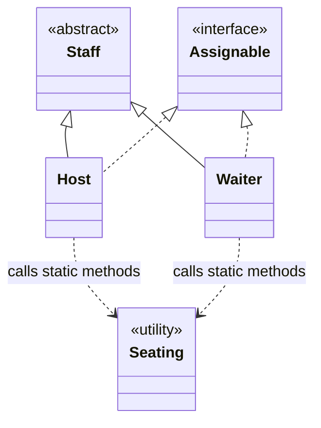

# Restaurant Rush — Chat History

Exported: 31 October 2026 (Asia/Singapore).

Scope: all user messages and user-facing assistant replies available in this conversation, through the request for this export. Includes progress updates, code blocks and the inline diagram. System/developer instructions, injected memories from other conversations and raw tool calls/results are excluded. The initial attachment-only message is described below. Linked files are references, not embedded attachments. This transcript preserves earlier illustrative examples and subsequent corrections in chronological order; it is not a consolidated implementation guide.

---

## 1. User — Attachments

_No text message._

Attached:
- `SC2002_Group_Project_Briefing.pdf`
- `SC2002_Restaurant_Rush_Group_Assignment.docx`

## Assistant

I see the **SC2002 project briefing** and **Restaurant Rush assignment** attached. Would you like me to summarise the requirements, review your repository against them, or help implement a specific part?

---

## 2. User

I need to add a Host to Restaurant Rush who can seat one customer per turn, in addition to the Waiter’s task. Given the existing Staff, Assignable and Waiter classes, suggest how to structure Host and reuse the seating logic without duplicating code.

## Assistant

Make **`Host` and `Waiter` sibling subclasses of `Staff`**, and extract the shared seating logic into a separate **`SeatingService`**.

**Avoid making `Host extends Waiter`** just to reuse seating code: a host is a type of staff member, but is not a specialised waiter and should not inherit unrelated waiter duties.

Assuming `Assignable` represents staff who can receive tasks, the structure could be:

```java
public class Host extends Staff implements Assignable {
    private final SeatingService seatingService;

    public Host(SeatingService seatingService) {
        // Call super(...) with your existing Staff constructor arguments.
        this.seatingService = seatingService;
    }

    // Call this from your existing Assignable task-execution method.
    public boolean seatCustomer(Customer customer, Table table) {
        return seatingService.seat(customer, table);
    }
}
```

Move the actual seating steps currently inside `Waiter` into the shared class:

```java
public class SeatingService {
    public boolean seat(Customer customer, Table table) {
        // Move the existing seating logic here:
        // 1. Validate the customer and table.
        // 2. Assign the customer to the table.
        // 3. Update the customer/table states and waiting queue.
        // Return true only when seating succeeds.
    }
}
```

Then have `Waiter` delegate to the **same service**:

```java
public boolean seatCustomer(Customer customer, Table table) {
    return seatingService.seat(customer, table);
}
```

These are structural sketches; constructor arguments, method names and the `Assignable` implementation should match your existing classes.

For **one customer per turn**, keep the action limit separate from the seating operation:

- Give each `Host` its own action allowance, reset at the beginning of each turn.
- Check that allowance before seating and consume it after a successful seating action.
- Preserve the Waiter’s existing action allowance independently, so the Host’s action is **additional to the Waiter’s task**.
- If `Staff` already tracks whether a staff member has acted, reuse that mechanism instead of adding a second flag.

**Why this works:** `Staff` shares staff identity and turn behaviour, `Assignable` defines the task contract, and `SeatingService` shares the seating operation. Both roles use one implementation, so a seating-rule change only needs to be made once.

If `Staff` already implements `Assignable`, the subclasses inherit that contract—you do not need to declare `implements Assignable` again.

---

## 3. User

Can you explain which methods Host should inherit from Staff and which it needs to implement from Assignable? Also, show how Host and Waiter can share Seating while keeping their own task limits.

## Assistant

**`Host` should inherit common staff behaviour from `Staff`, implement the task contract required by `Assignable`, and delegate seating to a shared `Seating` object.** Each staff instance should hold its own task counter.

I don’t have your actual class definitions here, so the method names below illustrate the structure rather than match your code exactly.

| Where the method belongs | Example methods | Reason |
|---|---|---|
| `Staff` — inherited by both roles | `getName()`, `startTurn()`, `canAct()`, `consumeTask()` | These describe behaviour common to staff. |
| `Assignable` — implemented by each role | `assignTask(Task task)` | Each role decides which tasks it supports and how to execute them. |
| `Seating` — called by both roles | `seat(Customer customer, Table table)` | Seating rules should have one shared implementation. |

**An interface method only needs implementing in `Host` if a superclass has not already provided its implementation.** For example, if `Staff` implements `Assignable` and provides a concrete `assignTask()`, `Host` inherits it. If that method remains abstract, `Host` must implement it.

Here is one possible design. In this example, `assignTask()` immediately executes a task; if your game queues assignments, the limit should instead be checked and consumed when the task executes.

```java
public interface Assignable {
    boolean assignTask(Task task);
}
```

Keep task limits in `Staff`, using **instance fields**, not `static` fields:

```java
public abstract class Staff implements Assignable {
    private final String name;
    private final int tasksPerTurn;
    private int tasksUsed;

    protected Staff(String name, int tasksPerTurn) {
        this.name = name;
        this.tasksPerTurn = tasksPerTurn;
    }

    public String getName() {
        return name;
    }

    public void startTurn() {
        tasksUsed = 0;
    }

    public boolean canAct() {
        return tasksUsed < tasksPerTurn;
    }

    protected void consumeTask() {
        tasksUsed++;
    }

    @Override
    public abstract boolean assignTask(Task task);
}
```

Both roles now inherit the counter logic, but **each object has a separate counter**. Sharing code does not mean sharing state.

Move the existing seating operation out of `Waiter` and into `Seating`:

```java
public class Seating {
    public boolean seat(Customer customer, Table table) {
        // Illustrative methods: adapt to your existing model.
        if (!customer.isWaiting() || !table.isAvailable()) {
            return false;
        }

        table.seat(customer);
        customer.setTable(table);

        // Also perform existing queue/state updates here.
        return true;
    }
}
```

`Host` supports only seating and has a limit of one successful task per turn:

```java
public class Host extends Staff {
    private final Seating seating;

    public Host(String name, Seating seating) {
        super(name, 1);
        this.seating = seating;
    }

    @Override
    public boolean assignTask(Task task) {
        if (!canAct() || task.getType() != TaskType.SEAT) {
            return false;
        }

        boolean success = seating.seat(
            task.getCustomer(), task.getTable()
        );

        if (success) {
            consumeTask();
        }

        return success;
    }
}
```

`Waiter` uses the same seating operation while retaining its other tasks and existing limit:

```java
public class Waiter extends Staff {
    private final Seating seating;

    public Waiter(String name, int tasksPerTurn, Seating seating) {
        super(name, tasksPerTurn);
        this.seating = seating;
    }

    @Override
    public boolean assignTask(Task task) {
        if (!canAct()) {
            return false;
        }

        boolean success;

        switch (task.getType()) {
            case SEAT:
                success = seating.seat(
                    task.getCustomer(), task.getTable()
                );
                break;

            default:
                success = performOtherWaiterTask(task);
                break;
        }

        if (success) {
            consumeTask();
        }

        return success;
    }

    private boolean performOtherWaiterTask(Task task) {
        // Keep the existing waiter task handling here.
        // Return false for unsupported or unsuccessful tasks.
        return false;
    }
}
```

Create one shared seating object and inject it into both:

```java
Seating seating = new Seating();

Host host = new Host("Alex", seating);
Waiter waiter = new Waiter("Sam", 1, seating);

// At the beginning of each turn:
host.startTurn();
waiter.startTurn();
```

With those example limits:

| Action in the same turn | Result |
|---|---|
| Host seats customer A | Host uses its one task. |
| Host tries to seat customer B | Rejected: Host has acted already. |
| Waiter performs its task | Allowed: Waiter still has its own allowance. |

The key separation is: **`Seating` controls whether seating is valid; each `Staff` object controls whether it has an action remaining.** This also means a failed seating attempt does not consume a task in this design.

---

## 4. User

Help me integrate Host into GameController so the order is Host, Waiter, then Chef. The Waiter should be able to take an order from a customer seated by Host in the same turn. Check that invalid seating attempts do not consume the Host’s task, and explain the changes needed.

### Assistant — Progress update

I’ll check the available project files for `GameController` and the staff classes, then work out the turn order and task-limit changes.

### Assistant — Progress update

Your Stage 3 code already registers Host → Waiter → Chef and refreshes the available tasks before each role acts. I’ll verify the same-turn order flow and check that rejected seating attempts preserve the Host’s task and restaurant state.

## Assistant

**Your repository’s Stage 3 code already implements this integration correctly.** No source changes are needed for the requested behaviour. My earlier examples were illustrative; your actual code uses `perform()`, `hasTaskAvailable()` and `markTaskUsed()`.

**1. Run Host → Waiter → Chef**

In [GameController.java](sandbox:/workspace/scratch/018679206659/Restaurant-Rush/stage-3/src/restaurant/control/GameController.java), the constructor already registers:

```java
this.directedStaff = List.of(new Host(), new Waiter(), new Chef());
```

At the start of each turn, it resets each staff member’s separate allowance:

```java
for (Assignable staff : directedStaff) {
    staff.startTurn();
}
```

It then executes their choices sequentially:

```java
for (Assignable staff : directedStaff) {
    direct(staff, turn);
}
```

**Why this works:** the Host finishes its action before the Waiter is asked to act.

**2. Refresh the Waiter’s choices after Host acts**

Inside `direct()`, your controller calculates options from the current restaurant state:

```java
List<TaskOption> options = staff.availableTasks(restaurant);
```

Successful seating immediately changes the customer to `SEATED`. The Waiter’s `availableTasks()` then includes that customer:

```java
for (Customer customer :
        restaurant.getCustomersIn(CustomerState.SEATED)) {
    options.add(new TaskOption(
        "order " + customer.getId(),
        "take the order of " + customer.describe()
    ));
}
```

Therefore, one turn can contain:

| Role | Action | Result |
|---|---|---|
| Host | `seat C1 T1` | C1 becomes `SEATED`. |
| Waiter | `order C1` | C1’s order is created. |
| Chef | `cook C1` | That order advances one preparation unit. |

The important detail is **recalculating options when each role acts**, rather than reusing the start-of-turn display’s options.

**3. Consume the Host’s task only after successful seating**

Your [Host.java](sandbox:/workspace/scratch/018679206659/Restaurant-Rush/stage-3/src/restaurant/entity/Host.java) already uses the correct sequence:

```java
checkTaskAvailable();
Table table = Seating.seat(command, restaurant);
markTaskUsed();
```

If `Seating.seat()` throws `InvalidActionException`, execution skips `markTaskUsed()`. The controller catches the exception and repeats the prompt:

```java
catch (InvalidActionException e) {
    ui.error(e.getMessage()
        + " Choose again (" + staff.getCommandHelp() + ").");
}
```

I traced these rejection paths in the source:

| Invalid attempt | Why Host retains its task |
|---|---|
| Missing arguments | Command validation throws before seating. |
| Unknown customer or table | Lookup throws before seating. |
| Occupied table | `Restaurant.seat()` rejects before changing state. |
| Customer already seated | Customer-state validation rejects before changing state. |
| No free table | Free-table lookup throws before seating. |

Both Host and Waiter call the shared `Seating.seat()` method, but their inherited `taskUsed` fields belong to **separate objects**, so Host seating does not consume the Waiter’s task.

**Verification limitation:** these checks were verified by source inspection. I attempted compilation and runtime checks, but this environment has `java` without `javac`, so I could not execute them.

---

## 5. User

Walk me through a turn where Host seats C1, Waiter takes C1’s order, and Chef starts cooking. Then explain what happens if I select an occupied table and retry with a free table in the same turn.

## Assistant

**All three actions can happen in the same turn because each staff member has their own task allowance, and the restaurant state updates immediately after each successful action.**

Assume C1 is waiting and T1 is free.

**1. Start of the turn**

`GameController` calls `startTurn()` on each staff member, resetting their individual `taskUsed` flags.

| Staff | Task available? |
|---|---|
| Host | Yes |
| Waiter | Yes |
| Chef | Yes |

**2. Host seats C1**

You enter:

```text
seat C1 T1
```

The Host executes:

```java
checkTaskAvailable();
Table table = Seating.seat(command, restaurant);
markTaskUsed();
```

The shared seating logic validates the command and calls `Restaurant.seat()`. This:

- Removes C1 from the waiting queue.
- Assigns C1 to T1.
- Changes C1’s state from `WAITING` to `SEATED`.

Only then is the **Host’s** task marked as used. The Waiter and Chef still have theirs.

**3. Waiter takes C1’s order**

The controller now calls `direct(waiter, turn)`. It calculates the Waiter’s options **using the updated state**, so C1 appears as a seated customer whose order can be taken.

You enter:

```text
order C1
```

`Restaurant.takeOrder()` checks that C1 is `SEATED`, lets C1 choose a menu item, creates the order and locks its bill. C1 becomes `ORDERED`, and the Waiter’s task is consumed.

There is no requirement that C1 was seated on an earlier turn—**being seated now is sufficient**.

**4. Chef starts cooking**

The controller next calculates the Chef’s options. C1’s newly created order is available.

You enter:

```text
cook C1
```

The Chef advances that order by **one preparation unit**, consuming the Chef’s task.

For example:

| C1’s chosen item | After this cooking action |
|---|---|
| Salad: 1 unit | Order becomes `READY`. |
| Pasta: 2 units | One unit completed; one remains. |

Even if the dish becomes `READY`, it **cannot be served this turn**: the Waiter has already acted, and the controller does not return to the Waiter after the Chef.

At turn end, C1 still loses the applicable waiting satisfaction because the food has not been served.

---

Now consider a separate scenario: **T1 is occupied by C2, T2 is free, and C1 is waiting.**

**First attempt: `seat C1 T1`**

The Host has a task available, so the initial budget check passes. However, `Restaurant.seat()` detects that T1 is occupied and throws `InvalidActionException` **before modifying the queue, table or customer**.

```java
Table table = Seating.seat(command, restaurant); // Throws here
markTaskUsed();                                  // Not reached
```

Consequently:

| State | After the rejected attempt |
|---|---|
| C1 | Still waiting |
| T1 | Still occupied by C2 |
| T2 | Still free |
| Host’s task | Still available |

The controller catches the exception, explains the failure and asks the **Host** to choose again. It does not advance to the Waiter yet.

**Retry: `seat C1 T2`**

This attempt succeeds: C1 becomes seated at T2, and **now** `markTaskUsed()` consumes the Host’s task. The controller then moves to the Waiter, who can immediately enter `order C1`, followed by the Chef entering `cook C1`.

**The rule is one successful seating per Host per turn—not one attempt.** Invalid attempts preserve both the task allowance and the restaurant state.

---

## 6. User

Inspect the project’s Java classes and help me create UML class diagrams showing the Entity-Control-Boundary structure, important attributes and methods, inheritance, interface implementation, and associations. Split them into a package overview, domain model, and control/boundary/staff view so they remain readable. Flag missing source files rather than guessing.

### Assistant — Progress update

I’ll inspect the Stage 3 Java sources and build three UML views from the actual declarations and relationships. I’ll flag any missing classes or unresolved references rather than fill them in by assumption.

### Assistant — Progress update

I found 31 Java source files and no missing project-internal imports. Two details matter for the diagrams: `Staff` does not implement `Assignable`—Host, Waiter and Chef do—and `ConsoleUI` depends on `Objective.TargetCheck`, so the package overview must show a Boundary-to-Control dependency. I’ll keep the diagrams as editable Markdown alongside the source.

## Assistant

Created [UML.md](sandbox:/workspace/scratch/018679206659/Restaurant-Rush/stage-3/docs/UML.md) with three editable Mermaid diagrams:

1. **Package overview** — actual dependencies between App, Entity, Control and Boundary.
2. **Domain model** — customers, orders, tables, menu, combos, pricing and ledger, with important members and multiplicities.
3. **Control/boundary/staff view** — controller coordination, UI, staff inheritance, interface implementation and shared seating.

I inspected **31 Java files**; **no missing project-internal imports were found**. Deliberately omitted utility classes are documented.

Important source details reflected in the diagrams:

- Host, Waiter and Chef implement `Assignable`; `Staff` and Cashier do not.
- `Seating` is a package-private static utility shared by Host and Waiter.
- ComboMeal references existing MenuItems, so its component links use associations rather than exclusive ownership.
- `Objective.TargetCheck` is nested inside `Objective.java`, not a missing file.
- Boundary depends on Control through `Objective.TargetCheck`.

Visibility, abstract/static methods and relationship notation are explained in the document. Source coverage and diagram structure were checked; visual rendering and Java compilation were not verified.

---

## 7. User

Check the diagrams against the available source code, especially the relationships between Staff, Assignable, Host, Waiter and Seating. Explain any corrections to the arrows, visibility symbols or multiplicities, and identify details that cannot be verified because files are missing.

### Assistant — Progress update

I’ll compare the saved diagrams with the available Java files, focusing on inheritance, interface implementation, shared seating, visibility and multiplicities.

## Assistant

**The main relationships were already correct.** I checked the available Stage 3 sources and updated [UML.md](sandbox:/workspace/scratch/018679206659/Restaurant-Rush/stage-3/docs/UML.md) to clarify constructors, abstract interface methods and `Seating`’s visibility.

**Arrows between the five classes**



| Relationship | Correct notation | Reason |
|---|---|---|
| Host/Waiter → Staff | Solid line, hollow triangle pointing to `Staff` | Both declare `extends Staff`. |
| Host/Waiter → Assignable | Dashed line, hollow triangle pointing to `Assignable` | Both declare `implements Assignable`. |
| Host/Waiter → Seating | Dashed dependency arrow pointing to `Seating` | They call its static methods; neither stores a `Seating` object. |
| Staff → Assignable | **No arrow** | `Staff` does not implement this interface. |
| Host → Waiter | **No inheritance arrow** | They are sibling subclasses. |

Although `Staff` does not implement `Assignable`, its inherited public `getName()` and `startTurn()` methods satisfy those interface requirements for Host and Waiter.

**Visibility and method notation**

| Source member | UML notation | Explanation |
|---|---|---|
| `Staff.name`, `Staff.taskUsed` | `-` | Private fields; subclasses use methods to access the task budget. |
| `Staff(String name)` | `#` | Protected constructor. |
| `checkTaskAvailable()`, `markTaskUsed()` | `#` | Protected methods available to subclasses. |
| `getName()`, `startTurn()`, `hasTaskAvailable()` | `+` | Public methods. |
| All `Assignable` methods | `+`, abstract | Interface declarations are implicitly public and abstract here. |
| Waiter’s `seat()`, `takeOrder()`, `serve()` | `-` | Private helper methods, distinct from public `perform()`. |
| `Seating.options()`, `Seating.seat()` | `~`, static | Package-private static methods. |
| `Seating()` | `-` | Private constructor prevents ordinary instantiation. |

`Seating` itself is **package-private and final**. Neither `~` nor a static marker alone expresses finality, so the document now records that explicitly. Mermaid uses a trailing `$` for static operations; conventional UML underlines them.

**Multiplicities**

- **Do not put multiplicities on inheritance, realization or dependency arrows.** In particular, Host → Seating should not say `1`: there is no owned seating-service instance.
- `GameController` has **three directed staff objects**: one Host, one Waiter and one Chef. The `3` counts objects, not tasks.
- “One task per turn” is a **behavioural constraint**, represented by each staff object’s separate `taskUsed` field.
- Customer–Table remains **`0..1` at both ends**: a customer may be unseated, and a table may be empty.
- Customer–Order remains **one customer per order, zero or one order per customer**.
- ComboMeal’s two component references remain ordinary associations: existing MenuItems are shared, so exclusive composition diamonds would be misleading.

I also added Waiter’s direct dependency on `Restaurant`, since ordering and serving call it directly.

**Missing-source findings:** all five focal files are present, and all project-internal imports resolve among the **31 available Java files**. Nothing in these relationships is blocked by missing source. `Objective.TargetCheck` is declared inside `Objective.java`; it does not require a separate file. This review verifies the local source structure, not compilation or rendered diagram layout.

---

## 8. User

create a markdown file for this entire chat history

### Assistant — Progress update

I’ll create a Markdown transcript of all user messages and assistant replies in this chat, including the code examples and diagrams. System instructions and raw tool logs will be excluded.

---

_End of transcript at the export request. The delivery reply for this file is not included._
